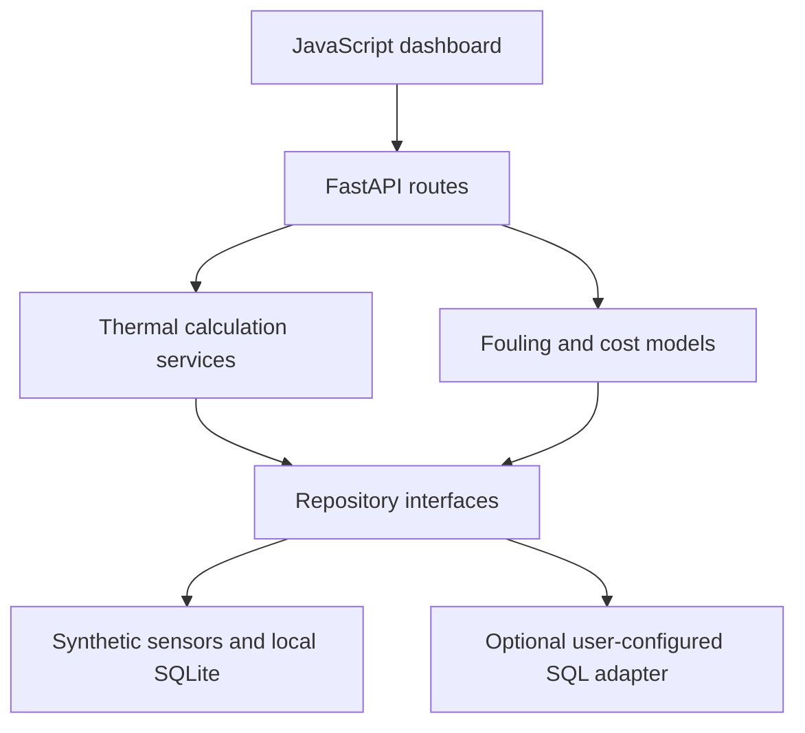

# Heat Exchanger Optimizer

**Thermal performance analytics, fouling forecasting and cost-based cleaning recommendations.**

A Python/FastAPI backend and JavaScript dashboard for calculating heat-exchanger performance,
detecting cleaning cycles, fitting fouling trends and exploring maintenance cost scenarios.
This public portfolio edition runs with **synthetic equipment, sensor readings and costs**.
It includes no company datasets or credentials.

## What it demonstrates

- **Engineering calculations:** heat duty, logarithmic mean temperature difference (LMTD),
  correction factor, overall heat-transfer coefficients and approach temperature.
- **Predictive analytics:** invalid-reading filtering, daily aggregation, cleaning-cycle detection,
  linear/asymptotic fouling models, previous-cycle priors and forecast confidence indicators.
- **Maintenance economics:** compare fuel loss, cleaning expense and downtime; recommend the
  earlier of the cost optimum and a minimum-cleanliness threshold.
- **Full-stack development:** typed FastAPI models, modular services and repositories, an
  interactive dashboard with SVG charts, scenario controls, calculation history and cleaning logs.
- **Offline analysis:** prepare local readings, review cleaning cycles and backtest fouling forecasts.

## Run locally

Use Python 3.11 or newer. From the repository root:

```powershell
python -m venv .venv
.\.venv\Scripts\python.exe -m pip install -r requirements.txt
Copy-Item backend/.env.example backend/.env
cd backend
..\.venv\Scripts\python.exe -m uvicorn app.main:app --host 127.0.0.1 --port 8001
```

In a second terminal, from the repository root:

```powershell
.\.venv\Scripts\python.exe -m http.server 5501 --bind 127.0.0.1 --directory frontend
```

Open **http://127.0.0.1:5501/**. API documentation: **http://127.0.0.1:8001/docs**.
On macOS/Linux, use `.venv/bin/python` and copy `.env.example` with `cp`.

The default `HX_DEMO=1` uses synthetic sensors and local SQLite storage. The prediction
screen initially shows generated historical readings. Turn off “Show demo data” to
analyse calculations saved in this local checkout; a short history may report insufficient data.
Automatic background calculation is off by default (`HX_AUTO_CALC_MINUTES=0`).

## Architecture



| Directory | Responsibility |
| --- | --- |
| `backend/app/calculations` | Thermal equations |
| `backend/app/services` | Calculation orchestration and optional scheduler |
| `backend/app/prediction` | Cleaning detection, fouling models, forecasts and costs |
| `backend/app/repositories` | SQL adapters and local demo storage |
| `backend/app/data` | Invented example equipment and economic settings |
| `frontend` | Dashboard pages, SVG charts and API integration |
| `tools` | Generic offline preparation, review and backtesting utilities |
| `backend/tests` | Numerical, privacy-boundary and route-handler checks |

## API examples

| Method | Route | Purpose |
| --- | --- | --- |
| GET | `/exchangers` | List example equipment |
| GET | `/exchanger/live-inputs?name=DEMO-HX-01` | Synthetic inputs in demo mode |
| POST | `/exchanger/calculate?name=DEMO-HX-01` | Calculate and save performance |
| GET | `/history` | Locally stored calculations |
| GET | `/prediction/summary?source=demo` | Generated-history overview |
| GET | `/prediction/exchanger?name=DEMO-HX-01&source=demo` | Forecast and cost curves |
| POST / DELETE | `/prediction/cleanings` | Maintain local cleaning dates |

## Offline utilities

`tools/prepare_training.py` accepts locally supplied CSVs named
`data/raw/DEMOHX01_readings.csv`.
The expected columns are defined by its `load()` function. Use `--help` for options.
`tools/plot_cycles.py` generates a local cycle-review HTML page;
`tools/train_model.py` backtests prepared readings. No source CSVs or backtest results
are shipped, and generated datasets are ignored by Git.

## Tests

From the repository root:

```powershell
cd backend
..\.venv\Scripts\python.exe -m unittest discover -s tests -v
```

The suite uses generated data and temporary local storage. No company system is contacted.
It checks numerical models, route handlers and OpenAPI generation without opening a network server.

## Optional SQL integration

The repository layer retains parameterised SQL integration code. To adapt it to your own
test environment, install `requirements-sql.txt`, provide an appropriate ODBC driver,
set your own database settings in the ignored `backend/.env`, and explicitly set `HX_DEMO=0`.
The queries document the expected table/column contract; adapt them to your own schema.
No original database, schema dump, server address or account is included.

## Scope and limitations

This is a local portfolio demonstration, not a deployed or authenticated production service.
It intentionally replaces the original fixed-credential login with a demo entry page.
Run it on loopback only. Predictions illustrate the implementation; synthetic results are
not evidence of plant performance or validation for operational maintenance decisions.
Physical quantities use the units shown by the code/UI (including kcal, kg/h and °C),
and costs are illustrative INR values. Domain review is needed before operational use.

## Author

[Ritika Gupta](https://github.com/Ritika457) · Senior Developer
